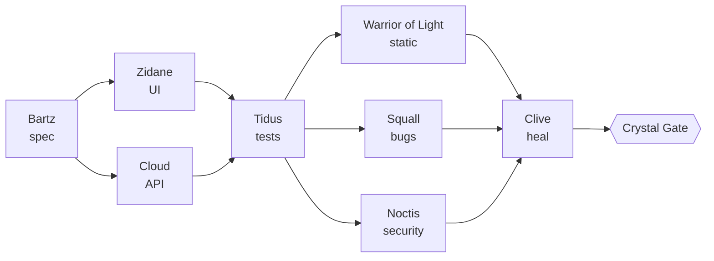

# ✦ Warriors of Light ✦

[English](README.md) · **Bahasa Indonesia**

**Kru Claude Code untuk aplikasi Flutter, mobile, dan web.** 16 pahlawan. 14 skill. 5 mantra yang tidak memakan token sama sekali. Satu gerbang yang tidak bisa dilewati merge mana pun.

[](https://github.com/saimskywalker/warriors-of-light/actions/workflows/ci.yml) [](LICENSE) [](https://docs.anthropic.com/en/docs/claude-code)

> 「光の戦士たちよ、クリスタルが汝らを選んだ。集え——このコードに調和を取り戻すために。」 *"Wahai Prajurit Cahaya, kristal telah memilih kalian. Berkumpullah, dan pulihkan harmoni dalam kode ini."*

---

Kamu adalah **Cosmos**. Kamu memanggil para pahlawan, dan mereka bertarung demi codebase-mu: satu merancang dari Figma, satu membangun layar, satu membayangkan semua cara layar itu bisa rusak, satu mereview kode pembayaranmu seperti seorang penyerang, satu membaca laporan crash-mu saat fajar. Di antara mereka berdiri **mantra (spells)**: hook shell biasa yang memblokir kesalahan yang biasa dibuat agen AI pukul 2 pagi (push ke `main`, menjalankan seluruh test suite di laptop, `cat` pada kunci penandatanganan) sebelum kesalahan itu terjadi, tanpa menghabiskan satu token pun.

## Mengapa

Agen coding AI itu cepat, dan itulah masalahnya. Kalau dibiarkan sendiri, mereka:

- **menulis kode terlalu banyak** (library untuk date picker, helper yang sebenarnya sudah ada);
- **menghabiskan token-mu** dengan memanggil helper untuk perubahan satu baris;
- **membuat laptopmu kepanasan** dengan `flutter test` dan build Gradle yang berjalan paralel;
- **melakukan merge dan push** yang seharusnya tidak mereka lakukan;
- **melupakan aturan** yang kamu tulis di prompt tiga jam lalu.

Warriors of Light menjawab tiap masalah itu dengan sesuatu yang tidak bisa lupa:

| Masalah               | Jawaban                                                                                                                                                                  |
|-----------------------|--------------------------------------------------------------------------------------------------------------------------------------------------------------------------|
| Kode terlalu banyak   | tangga kemalasan **Auron** (pakai ulang → stdlib → platform → minimal), dan mantra **Mini**: batas lunak 300, batas keras 500 baris per file                              |
| Boros token           | **Cosmos** bekerja sendiri dulu; pahlawan hanya untuk kerja paralel, pembacaan luas, atau review. Haiku mengumpulkan, Sonnet membangun, Opus menilai                      |
| Laptop membeku        | mantra **Slow**: satu pekerjaan berat dalam satu waktu, prioritas rendah, menunggu saat memori menipis, dibatasi waktu                                                    |
| Merge berbahaya       | mantra **Protect** menutup setiap jalan menuju branch yang dilindungi; **Crystal Gate** hanya melakukan merge jika CI hijau, tidak ada konflik, dan para reviewer bilang PASS |
| Aturan yang terlupakan | hook, bukan prompt: berjalan pada setiap pemanggilan tool, untuk setiap agen, setiap saat                                                                                |

## Panggil mereka dalam 60 detik

```
git clone https://github.com/saimskywalker/warriors-of-light.git
cd warriors-of-light
./install.sh --preset flutter ~/code/my-app      # or: web | fullstack
```

Buka sesi Claude Code **baru** di aplikasimu dan ucapkan:

```
Warriors of Light, assemble!
```

Bersifat pribadi secara default: semuanya masuk ke `.claude/` dan disembunyikan dari git lewat `.git/info/exclude`. Tambahkan `--team` untuk meng-commit kru ini bagi semua orang. Hapus kapan saja dengan `./uninstall.sh ~/code/my-app`.

Membutuhkan `jq`, `git`, `perl`, dan `gh` untuk merge gate. macOS atau Linux.

## ⚔️ Para pahlawan (subagent)

| Pahlawan             | Dari | Peran                                                                                         | Model  | Akses       |
|----------------------|------|-----------------------------------------------------------------------------------------------|--------|-------------|
| **Bartz**            | V    | Membaca design system dan Figma-mu, menulis spesifikasi yang diikuti para builder             | sonnet | baca        |
| **Zidane**           | IX   | Membangun UI: widget Flutter atau komponen web, setiap state, setiap ukuran layar             | sonnet | ubah        |
| **Cloud**            | VII  | Membangun backend: API, function, migrasi, dashboard                                          | sonnet | ubah        |
| **Tidus**            | X    | Membayangkan skenario happy / edge / worst / abuse dan menulis tes yang belum ada             | sonnet | ubah tes    |
| **Squall**           | VIII | Review bug dan crash secara adversarial pada sebuah diff                                      | opus   | baca        |
| **Warrior of Light** | I    | Menafsirkan keluaran analyzer, type-checker, dan linter; menemukan apa yang terlewat          | sonnet | baca        |
| **Lightning**        | XIII | Membaca CI yang gagal, memisahkan kegagalan nyata dari flake dan noise runner                 | haiku  | baca        |
| **Clive**            | XVI  | Menyembuhkan tes yang gagal dengan cara jujur: tidak pernah men-skip, tidak pernah melonggarkan | sonnet | ubah        |
| **Cecil**            | IV   | Kode mati, dan file mana yang layak di-refactor (churn × bug × kompleksitas)                  | opus   | baca        |
| **Vaan**             | XII  | Menemukan setiap issue dan PR yang masih menunggu balasan seseorang                           | haiku  | baca        |
| **Terra**            | VI   | Teks di setiap bahasa, aturan listing toko dan permission prompt                              | sonnet | baca        |
| **Noctis**           | XV   | Keamanan auth, sesi, pembayaran, IAP, dan webhook, per PR                                     | opus   | baca        |
| **Firion**           | II   | Sapuan keamanan seluruh sistem: MASVS, OWASP Top 10, kebocoran, aturan Firebase/Supabase      | opus   | baca        |
| **Y'shtola**         | XIV  | Triase Crashlytics / Sentry: crash baru per versi, dipetakan ke file:baris                    | sonnet | baca        |
| **Shantotto**        | XI   | Jawaban database read-only (hanya agregat) dan review migrasi                                 | sonnet | baca        |
| **Luneth**           | III  | Performa dan analitik: app start, ANR, Web Vitals, funnel terhadap ambang batasmu             | sonnet | baca        |

Setiap reviewer mengakhiri laporannya dengan blok yang sama, sehingga keputusan bisa diambil secara mekanis:

```
VERDICT: PASS | BLOCK | NEEDS-HUMAN
AGENT: noctis
FINDINGS:
- [HIGH] lib/purchase/verify.dart:42 — receipt trusted from the client, never checked with the store
SUMMARY: one HIGH: server-side receipt validation is missing
```

## ✨ Para skill

| Skill         | Dimuat saat                                                                                                |
|---------------|------------------------------------------------------------------------------------------------------------|
| **Cosmos**    | pemanggilan, sebelum delegasi apa pun, memilih reviewer mana yang dibutuhkan sebuah diff                    |
| **Auron**     | sebelum menulis kode apa pun: tangga kemalasan, daftar yang tidak boleh dipangkas, batas ukuran, cepat secara default |
| **Lulu**      | sebelum menjalankan build dan tes: antrean Slow, tidak ada full suite di lokal                              |
| **Ignis**     | commit, rebase, isi PR: satu PR per fitur, tanpa atribusi AI, tidak pernah merge                            |
| **Rikku**     | CI sedang merah                                                                                             |
| **Relm**      | Figma → Flutter / web, dengan anggaran panggilan dan jebakan konversi                                       |
| **Rosa**      | setiap perubahan UI: aksesibilitas (semantics, kontras, skala teks, fokus, ukuran target sentuh)            |
| **Ashe**      | sebelum submit ke toko: checklist review App Store dan Google Play                                          |
| **Cid**       | rilis: semuanya disiapkan, lalu BERHENTI menunggumu                                                         |
| **Aerith**    | health check pagi: crash, performa, dan data dalam satu ringkasan                                           |
| **Laguna**    | pekerjaan tengah malam: selesaikan, tunggu CI hijau, merge lewat gate, istirahat                            |
| **Yuna**      | serah terima sebelum kamu mengosongkan konteks                                                              |
| **Steiner**   | kebocoran atau pembobolan: isolasi, rotasi, cabut, verifikasi, catat                                        |
| **Lunafreya** | "apa yang menunggu siapa": draf rekap atau standup, tidak pernah dikirim untukmu                            |

## 🛡️ Para mantra (hook, nol token)

| Mantra      | Mengawasi                  | Menghentikan                                                                                                                                                                                                                         |
|-------------|----------------------------|--------------------------------------------------------------------------------------------------------------------------------------------------------------------------------------------------------------------------------------|
| **Protect** | setiap perintah shell      | merge lokal; push ke `main` / `release/*`; push force, mirror, dan delete; merge lewat `gh api`; `--admin`; tag produksi; `firebase deploy`, `vercel --prod`, `fastlane release`, `eas submit`…; `cat` pada keystore                  |
| **Shell**   | setiap pembacaan dan edit file | kunci penandatanganan, service account, file env produksi                                                                                                                                                                        |
| **Silence** | tool SQL MCP-mu            | apa pun selain SELECT / WITH / EXPLAIN / SHOW; lock; sleep; multi-statement                                                                                                                                                          |
| **Mini**    | setiap edit                | file yang membengkak melewati 300 baris (catatan) atau 500 baris (blokir)                                                                                                                                                            |
| **Slow**    | perintah berat             | eksekusi berat yang paralel; memori rendah; job yang lepas kendali                                                                                                                                                                   |

Semua pola ada di satu file, `.claude/wol/config.sh`, lengkap dengan preset untuk Flutter, web, dan fullstack.

## 🔮 Crystal Gate

`gh pr merge` hanya berfungsi lewat gate, dan gate hanya terbuka bila **semua** syarat berikut terpenuhi, dibaca langsung dari GitHub pada saat merge:

- Laguna dipanggil untuk PR ini **malam ini**, dan itu PR milikmu;
- bukan draft, tidak ada label `needs-human`;
- **MERGEABLE tanpa konflik**, merge state `CLEAN`, up to date dengan base;
- **semua check hijau** pada head commit;
- tidak ada review thread yang belum diselesaikan;
- tidak ada file CI, rilis, atau infra (itu di-merge oleh manusia);
- verdict `PASS` untuk commit yang persis ini dari setiap reviewer yang dibutuhkan diff.

```
.claude/wol/crystal/gate.sh 12 --report
✓ author is the owner
✓ mergeable, no conflict
✗ checks not green: test=IN_PROGRESS
✗ noctis verdict PASS for head 3c673ac2b missing
```

## 🗺️ Pipeline



- **Fitur baru**: Bartz → Zidane ∥ Cloud → Tidus → Warrior of Light ∥ Squall ∥ gate → Clive → Ignis
- **Crash di produksi**: Y'shtola → Squall → Tidus (tes reproduksi dulu) → perbaikan → Clive
- **CI merah**: Lightning → Warrior of Light / Clive
- **Refactor**: Cecil → Tidus (kunci perilaku dulu) → Zidane / Cloud → review
- **Rilis**: Cid → gate → **berhenti menunggumu** → 24 jam kemudian Y'shtola + Luneth terhadap ambang batasmu
- **Pagi**: Aerith → Y'shtola ∥ Luneth ∥ Shantotto → satu ringkasan
- **Tengah malam**: Laguna → selesaikan → CI → verdict → Crystal Gate → Yuna → istirahat

## 💬 Ucapkan seperti ini

```
Cosmos, send Noctis to review PR #12
Cosmos, run the refactor pipeline on lib/features/checkout
Relm, build this Figma frame: https://www.figma.com/design/…
Cid, prepare release 2.3.0
Aerith, run the health check
Laguna, finish PR #12 and rest
```

## Aturan kode (Auron)

1. **Baca dulu**, lalu berhenti di anak tangga pertama yang berlaku: apakah ini perlu ada → sudah ada di codebase → pustaka standar → fitur platform → dependency yang sudah terpasang → satu baris → baru kemudian yang minimal, ditambah satu tes kecil bila ada logika.
2. **Jangan pernah dipangkas**: validasi di batas kepercayaan, penanganan kehilangan data, keamanan, aksesibilitas, error yang bisa ditindaklanjuti, uang yang idempoten.
3. **Batas lunak 300 / keras 500 baris** per file yang ditulis tangan, ditegakkan oleh Mini.
4. **Tulis dengan benar sekali saja**: ikuti kode di sekitarnya, `switch` daripada tangga if, satu tipe state sealed daripada boolean, ekstrak pada pemakaian ketiga.
5. **Cepat secara default**: tanpa N+1, satu polling per layar, widget `const` dan `select` pada provider, tanpa layout shift, indeks dan paginasi, optimasi hanya yang terukur.

## FAQ

**Apakah ini jalan tanpa Figma, Crashlytics, atau database?** Ya. Pahlawan yang membutuhkan sumber yang belum kamu hubungkan akan memberi tahu dan berhenti; semua yang lain tetap bekerja.

**Apakah ini memperlambat Claude?** Para mantra adalah skrip shell kecil yang berjalan dalam hitungan milidetik. Penghematannya datang dari Cosmos yang mengerjakan sendiri pekerjaan kecil alih-alih memanggil agen.

**Bisakah saya mengubah batasnya?** Semuanya ada di `.claude/wol/config.sh`: branch yang dilindungi, perintah berat, perintah deploy, file rahasia, batas ukuran, aturan path untuk gate.

**Apakah merge gate menggantikan branch protection?** Ini adalah tembok lokal untuk agenmu. Gunakan juga branch protection GitHub jika paketmu mendukungnya.

## Berkontribusi

Pahlawan baru, mantra, preset (React Native, KMP, SwiftUI…), dan kasus uji sangat diterima. Lihat [CONTRIBUTING.md](CONTRIBUTING.md). Kalau kru ini pernah menyelamatkan malammu dari bencana, sebuah ⭐ membantu orang lain menemukannya.

## Kredit dan disclaimer

Tangga kemalasan diadaptasi dari [ponytail](https://github.com/DietrichGebert/ponytail) (MIT). Karya penggemar dan tidak resmi. FINAL FANTASY beserta karakternya adalah merek dagang Square Enix, yang tidak berafiliasi dengan maupun mendukung proyek ini; nama-nama tersebut hanya dipakai sebagai label peran. Tidak ada aset game yang disertakan.

MIT © saimskywalker
