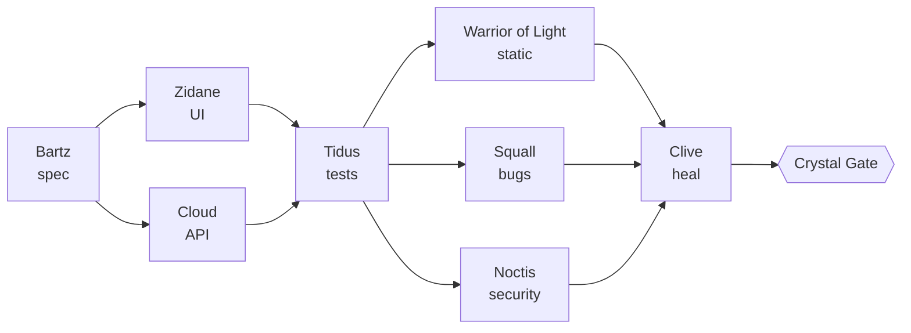

<div align="center">

# ✦ Warriors of Light ✦

**English** · [Bahasa Indonesia](README.id.md)

**AI agents for Claude Code, built for Flutter, mobile and web apps.**
16 heroes. 14 skills. 5 spells that cost zero tokens. One gate no merge gets past.

[](https://github.com/saimskywalker/warriors-of-light-ai-agents/actions/workflows/ci.yml)
[](LICENSE)
[](https://docs.anthropic.com/en/docs/claude-code)

> 「光の戦士たちよ、クリスタルが汝らを選んだ。集え——このコードに調和を取り戻すために。」
> *"Warriors of Light, the crystals have chosen you. Gather, and restore harmony to this code."*

</div>

---

You are **Cosmos**. You summon the heroes, and they fight for your codebase:
one designs from Figma, one builds the screen, one dreams up every way it can
break, one reviews your payments code like an attacker would, one reads your
crash reports at dawn. Between them stand **spells**: plain shell hooks that
block the mistakes an AI agent makes at 2 a.m. (a push to `main`, a full test
suite on a laptop, a `cat` of your signing key) before they happen, and
without spending a single token.

## Why

AI coding agents are fast, and that is the problem. Left alone they:

- **write too much code** (a library for a date picker, a helper that already exists);
- **spend your tokens** spawning helpers for one-line changes;
- **melt your laptop** with parallel `flutter test` and Gradle builds;
- **merge things they should not**, and push where they should not;
- **forget the rules** you wrote in a prompt three hours ago.

Warriors of Light answers each one with something that cannot forget:

| Problem | Answer |
|---|---|
| Too much code | **Auron**'s laziness ladder (reuse → stdlib → platform → minimal), and the **Mini** spell: soft 300, hard 500 lines per file |
| Token burn | **Cosmos** works alone first; heroes only for parallel work, wide reads or reviews. Haiku gathers, Sonnet builds, Opus judges |
| A frozen laptop | the **Slow** spell: one heavy job at a time, low priority, waits out low memory, time-limited |
| Dangerous merges | the **Protect** spell closes every road to protected branches; the **Crystal Gate** merges only when CI is green, there is no conflict, and the reviewers said PASS |
| Forgotten rules | hooks, not prompts: they run on every tool call, for every agent, every time |

## Summon them in 60 seconds

**As a Claude Code plugin** (recommended), inside Claude Code:

```
/plugin install warriors-of-light --marketplace saimskywalker/warriors-of-light-ai-agents
```

On an older Claude Code, add the marketplace first:
`/plugin marketplace add saimskywalker/warriors-of-light-ai-agents`, then
`/plugin install warriors-of-light@warriors-of-light`.

Then, in your app's folder, write the project's settings once (pick a preset):

```bash
wol init flutter      # or: web | fullstack
```

and say:

```
Warriors of Light, assemble!
```

Plugin agents and skills are namespaced (`warriors-of-light:noctis`), so
they never collide with your own. Settings and runtime state live in your
project's `.claude/wol/`; commit `config.sh` to share it with your team.

**Without plugins** (a script install into one project):

```bash
git clone https://github.com/saimskywalker/warriors-of-light-ai-agents.git
./warriors-of-light-ai-agents/install.sh --preset flutter ~/code/my-app   # add --team to commit the crew
```

Personal by default: everything lands in `.claude/` and is hidden from git
through `.git/info/exclude`. Remove it with `./uninstall.sh ~/code/my-app`.

Needs `jq`, `git`, `perl`, and `gh` for the merge gate. macOS or Linux.

### The `wol` command

| Command | What it does |
|---|---|
| `wol init <preset>` | writes `.claude/wol/config.sh` for this project |
| `wol slow '<command>'` | runs a heavy command through the queue |
| `wol gate <pr> --report` | shows every Crystal Gate condition for a PR |
| `wol libra` | queue holder, heavy processes, free memory, recent runs |
| `wol awake start` / `wol rest` | Laguna's keep-awake and end-of-run |

With the plugin, `wol` is on your PATH; after `install.sh` it is
`.claude/wol/bin/wol`.

## ⚔️ The heroes (subagents)

| Hero | From | Role | Model | Hands |
|---|---|---|---|---|
| **Bartz** | V | Reads your design system and Figma, writes the spec builders follow | sonnet | read |
| **Zidane** | IX | Builds UI: Flutter widgets or web components, every state, every screen size | sonnet | edit |
| **Cloud** | VII | Builds backend: APIs, functions, migrations, dashboards | sonnet | edit |
| **Tidus** | X | Dreams up happy / edge / worst / abuse scenarios and writes the missing tests | sonnet | edit tests |
| **Squall** | VIII | Adversarial bug and crash review of a diff | opus | read |
| **Warrior of Light** | I | Interprets analyzer, type-checker and linter output; finds what they miss | sonnet | read |
| **Lightning** | XIII | Reads failing CI, separates real failures from flakes and runner noise | haiku | read |
| **Clive** | XVI | Heals failing tests the honest way: never skips, never loosens | sonnet | edit |
| **Cecil** | IV | Dead code, and which files are worth refactoring (churn × bugs × complexity) | opus | read |
| **Vaan** | XII | Finds every issue and PR still waiting on someone's reply | haiku | read |
| **Terra** | VI | Copy in every language, store-listing and permission-prompt rules | sonnet | read |
| **Noctis** | XV | Security of auth, sessions, payments, IAP and webhooks, per PR | opus | read |
| **Firion** | II | Whole-system security sweep: MASVS, OWASP Top 10, leaks, Firebase/Supabase rules | opus | read |
| **Y'shtola** | XIV | Crashlytics / Sentry triage: new crashes per version, mapped to file:line | sonnet | read |
| **Shantotto** | XI | Read-only database answers (aggregates only) and migration review | sonnet | read |
| **Luneth** | III | Performance and analytics: app start, ANR, Web Vitals, funnels vs your thresholds | sonnet | read |

Every reviewer ends with the same block, so decisions are mechanical:

```
VERDICT: PASS | BLOCK | NEEDS-HUMAN
AGENT: noctis
FINDINGS:
- [HIGH] lib/purchase/verify.dart:42 — receipt trusted from the client, never checked with the store
SUMMARY: one HIGH: server-side receipt validation is missing
```

## ✨ The skills

| Skill | Loads when |
|---|---|
| **Cosmos** | the summon, before any delegation, choosing which reviewers a diff needs |
| **Auron** | before writing any code: the laziness ladder, the never-cut list, the size limits, fast by default |
| **Lulu** | before running builds and tests: the Slow queue, no full suites locally |
| **Ignis** | commits, rebases, PR bodies: one PR per feature, no AI attribution, never merge |
| **Rikku** | CI is red |
| **Relm** | Figma → Flutter / web, with a call budget and the conversion traps |
| **Rosa** | any UI change: accessibility (semantics, contrast, text scale, focus, touch targets) |
| **Ashe** | before a store submission: App Store and Google Play review checklist |
| **Cid** | releases: everything prepared, then it STOPS for you |
| **Aerith** | the morning health check: crashes, performance and data in one summary |
| **Laguna** | the midnight run: finish, wait for green CI, merge through the gate, rest |
| **Yuna** | the handoff before you clear context |
| **Steiner** | a leak or breach: contain, rotate, revoke, verify, record |
| **Lunafreya** | "what is waiting on whom": a recap or standup draft, never sent for you |

## 🛡️ The spells (hooks, zero tokens)

| Spell | Watches | Stops |
|---|---|---|
| **Protect** | every shell command | local merges; pushes to `main` / `release/*`; force, mirror and delete pushes; `gh api` merges; `--admin`; production tags; `firebase deploy`, `vercel --prod`, `fastlane release`, `eas submit`…; `cat` of a keystore |
| **Shell** | every file read and edit | signing keys, service accounts, production env files |
| **Silence** | your SQL MCP tools | anything but SELECT / WITH / EXPLAIN / SHOW; locks; sleeps; multi-statements |
| **Mini** | every edit | files growing past 300 (a note) or 500 lines (a block) |
| **Slow** | heavy commands | parallel heavy runs; low memory; runaway jobs |

All patterns live in one file, `.claude/wol/config.sh`, with presets for
Flutter, web and fullstack.

### What Protect can and cannot see

Protect judges what would really run, not just the first word: it unwraps
`sh -c` / `bash -c` / `eval`, `$(...)` and backticks, and strips `env`,
`nice`, `nohup`, `sudo`, `xargs`, `command`, a leading `\` and git's `-C` /
`-c` options before applying the rules. A command held in a variable
(`$CMD push …`) cannot be read before it runs, so a line like that is
refused whenever it could push or merge.

It is a guard rail for an agent, not a sandbox for an attacker: a script
file that pushes, an alias defined in your shell profile, or a binary on
your `PATH` is out of its sight. Keep GitHub branch protection on as well.

## 🔮 The Crystal Gate

`gh pr merge` works only through the gate, and the gate opens only when
**all** of these hold, read live from GitHub at the moment of the merge:

- Laguna was invoked for this PR **tonight**, and it is your PR;
- not a draft, no `needs-human` label;
- **MERGEABLE with no conflict**, merge state `CLEAN`, up to date with the base;
- **every check green** on the head commit;
- no unresolved review thread;
- no CI, release or infra files (a human merges those);
- a `PASS` verdict for this exact commit from each reviewer the diff needs.

```bash
wol gate 12 --report
✓ author is the owner
✓ mergeable, no conflict
✗ checks not green: test=IN_PROGRESS
✗ noctis verdict PASS for head 3c673ac2b missing
```

## 🗺️ Pipelines



- **New feature**: Bartz → Zidane ∥ Cloud → Tidus → Warrior of Light ∥ Squall ∥ gates → Clive → Ignis
- **Production crash**: Y'shtola → Squall → Tidus (repro test first) → fix → Clive
- **CI red**: Lightning → Warrior of Light / Clive
- **Refactor**: Cecil → Tidus (pin behaviour first) → Zidane / Cloud → reviews
- **Release**: Cid → gates → **stop for you** → 24 h later Y'shtola + Luneth vs your thresholds
- **Morning**: Aerith → Y'shtola ∥ Luneth ∥ Shantotto → one summary
- **Midnight**: Laguna → finish → CI → verdicts → Crystal Gate → Yuna → rest

## 💬 Say it like this

```
Cosmos, send Noctis to review PR #12
Cosmos, run the refactor pipeline on lib/features/checkout
Relm, build this Figma frame: https://www.figma.com/design/…
Cid, prepare release 2.3.0
Aerith, run the health check
Laguna, finish PR #12 and rest
```

## The code rules (Auron)

1. **Read first**, then stop at the first rung that holds: does it need to
   exist → already in the codebase → standard library → platform feature →
   installed dependency → one line → only then the minimum, plus one small
   test when it has logic.
2. **Never cut**: validation at trust boundaries, data-loss handling,
   security, accessibility, actionable errors, idempotent money.
3. **Soft 300 / hard 500 lines** per hand-written file, enforced by Mini.
4. **Write it right once**: follow the surrounding code, `switch` over
   if-ladders, one sealed state type over booleans, extract on the third use.
5. **Fast by default**: no N+1, one poll per screen, `const` widgets and
   provider `select`, no layout shift, indexes and pagination, measured
   optimisation only.

## 📊 Benchmark: try it, tell us

Four tasks, run in a plain project and with the crew, scored by objective
checks (tests pass, bugs named, `main` untouched, nothing else changed):

```bash
bench/run.sh --dry            # free: checks the plumbing
bench/run.sh --runs 3         # real sessions; the report prints the cost
```

Then [share your table](https://github.com/saimskywalker/warriors-of-light-ai-agents/issues/new?template=benchmark.yml)
or [tell us what a hero got wrong](https://github.com/saimskywalker/warriors-of-light-ai-agents/issues/new?template=feedback.yml).
We publish no numbers until they come from runs like yours. Details: [bench/README.md](bench/README.md).

## FAQ

**Does it work without Figma, Crashlytics or a database?** Yes. Heroes that
need a source you have not connected say so and stop; everything else works.

**Will it slow Claude down?** The spells are small shell scripts that run in
milliseconds. The savings come from Cosmos doing small work itself instead
of spawning agents.

**Can I change the limits?** Everything is in `.claude/wol/config.sh`:
protected branches, heavy commands, deploy commands, secret files, size
limits, the gate's path rules.

**Is the merge gate a replacement for branch protection?** It is a local
wall for your agent. Use GitHub branch protection too when your plan has it.

## Contributing

New heroes, spells, presets (React Native, KMP, SwiftUI…) and test cases are
welcome. See [CONTRIBUTING.md](CONTRIBUTING.md). If the crew saved you a bad
night, a ⭐ helps others find it.

## Credits and disclaimer

The laziness ladder is adapted from [ponytail](https://github.com/DietrichGebert/ponytail) (MIT).
Fan-made and unofficial. FINAL FANTASY and its characters are trademarks of
Square Enix, which is not affiliated with and does not endorse this project;
the names are used only as role labels. No game assets are included.

MIT © saimskywalker
